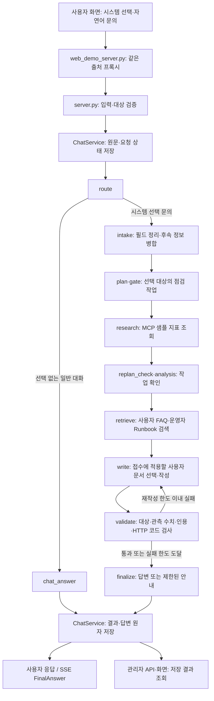

# AI 헬프데스크 코드·문서 안내

프로젝트 소개와 최신 실행 방법은 [루트 README](../README.md)를 먼저 읽는다.
이 문서는 1~7단계와 후속 접수·답변 보완이 반영된 구조와 파일을 설명한다. 기존 실습의 Wave 번호는 구현 단계
1~7과 다른 구분이며, 각 단계 문서는 작성 당시 동작과 검증 결과를 보존한다.

현재 기본 실행은 **Ollama Qwen 생성 + OpenAI 임베딩**이다. 시스템 지표는 샘플이고,
관리자 조회는 인증 없는 로컬 시연용이다. 실제 운영 장애의 원인 확정·자동 복구는 수행하지 않는다.

## 읽는 순서

| 목적 | 문서 |
|---|---|
| 실행·설정·전체 기능 | [루트 README](../README.md) |
| 발표 자료 | [21장 템플릿 PPT와 발표 노트 안내](presentation/README.md) |
| 기존 문제와 개선 설명 | [기획·분석 보고서](final_report.md) |
| 실제 Qwen·OpenAI 화면 | [템플릿용 UI·LangSmith 실행 기록](evidence/template_final_20261021/README.md) |
| 시연 후 발견한 문제의 보완 | [접수 스키마·HTTP 코드 안내 검증](evidence/post_demo_fixes/README.md) |
| 원본과 6단계 완료본 비교 | [고정 버전·화면·조건](evidence/final/README.md) |
| 검색 공급자 선택 근거 | [Ollama/OpenAI 실측 결과](evidence/embedding_comparison/RESULTS.md) |
| 개발 순서와 기록 원칙 | [구현 계획](implementation_plan.md), [변경·증거 기록 방법](change_evidence_workflow.md) |

발표·UI 자료는 [adce28f](https://github.com/gayeon9-9/skala_ai_mini_project/commit/adce28f),
7단계 실제 임베딩 비교는 [1517e8d](https://github.com/gayeon9-9/skala_ai_mini_project/commit/1517e8d)에
기록했다. 후속 코드 변경을 이 과거 측정의 결과로 소급하지 않는다.

## 현재 문의 처리 흐름



선택한 시스템의 문의는 일반 대화로 분류하지 않고 접수 경로를 탄다. 선택 대상의 점검
작업을 코드로 만들고 도구 호출 직전에도 대상을 검사한다. 미확인 접수 항목이 있어도 기본
점검을 막지 않는다. `analysis` 작업이 없으면 해당 노드는 건너뛰고 검색으로 이동한다.

사용자 FAQ와 운영자 Runbook을 따로 검색한다. 사용자 답변 생성에는 사용자용 문서만
전달하고, 운영자 문서는 관리자 조회를 위해 별도로 저장한다. 검증 실패가 반복되면 마지막
초안을 합격시키지 않고 확인된 관측으로 제한한 안내를 만든다.

후속 보완에서는 접수 필드의 상태별 JSON Schema와 출력 예시를 명확히 하고, 원문 검사를
거친 누적 접수 정보를 작성 단계에 구조화해 전달한다. 접수된 오류 메시지에 없는 HTTP
4xx/5xx 코드가 있는 절은 작성 근거에서 제외한다. 10월 22일부터 문서를 H2 절로 분리해
일반 안내를 유지하며, 절 정보가 없는 과거 결과는 문서 전체 검사로 처리한다. 프롬프트·검증·
fake 작성기·제한된 안내가 같은 절 선택 규칙을 쓰며, 원본 검색 결과와 관리자 근거는 보존한다.
검색은 됐지만 적용할 문서가 모두 제외되면 답변 생성 LLM을 호출하지 않고 고정 안내를
검증한다. 일반 작성은 최초 1회와 재작성 최대 2회, 총 3회 작성·검증 후 제한된 안내로 종료한다.
모델이 출처처럼 붙인 내부 항목명 표시는 검증 전에 제거하며, 문장과 실제 문서 인용은 유지한다.
허용 근거는 상태가 `provided`인 접수 오류 메시지 값이다. 없음·모름·미언급 상태나 문서·
샘플 지표의 코드만으로 허용하지 않는다. 이 검사는 HTTP 4xx/5xx 형식 규칙이며 모든 문장
의미와 장애 원인을 판단하는 기능은 아니다.
기존 보완은 [별도 기록](evidence/post_demo_fixes/README.md)을 따른다. 최신 절 분리와
제한된 해석 오류 규칙은 [루트 README의 후속 보완](../README.md#2026-10-22-후속-보완과-코드-읽는-순서)을 참고한다.
`answer_claims.py`는 원인 추정·인용 문서 무관 단정·근거 없는 캐시 삭제 같은 알려진
표현을 검사하며 범용 의미 판정이나 두 번째 AI 에이전트가 아니다.

모델이 일부 항목을 잘못 추출해도 정상 항목을 버리지 않는다. 원문 규칙으로 누락 항목을
보완한 경우 `model_with_rules`와 `supplemented_fields`를 기록하고 화면에 표시한다.
문서 절 ID는 실행 추적에만 남겨 모델의 문서 인용과 구분한다.

POST와 SSE는 같은 `ChatService`를 사용한다. 원문을 먼저 저장하고, 결과·답변·상태의
저장을 마친 뒤 완료 응답을 보낸다. 동일 `request_id`의 완료 요청은 저장 결과를 재사용한다.
`completed`는 답변 저장 상태이며 운영 장애 상태가 아니다.

## 파일별 역할

| 파일 | 읽을 내용 |
|---|---|
| `server.py` | 요청 스키마, API, lifespan의 LLM·MCP·저장소·검색기 조립 |
| `agent/deps.py` | `SupervisorDeps`에 전달하는 의존성 |
| `agent/graph.py` | 노드 연결과 상태, 접수·점검·검색·작성·검증 분기 |
| `agent/chat_service.py` | POST/SSE 공통 처리, 중단·실패·재전송, 저장 이후 응답 |
| `agent/session_store.py` | SQLite 연결·잠금·트랜잭션과 메시지 |
| `agent/inquiry_store.py`, `inquiry_models.py` | 접수·요청 상태, 충돌, 완료 결과·이력 조회 |
| `agent/intake.py`, `intake_llm.py` | 필드 스키마·원문 근거·없음/모름 구분·후속 병합 |
| `agent/embeddings.py` | Ollama/OpenAI 어댑터와 공급자 선택 |
| `agent/retrieval.py` | 문서 분할·색인 캐시·시스템/용도 필터·유사도 검색 |
| `agent/answer_generation.py` | 적용 가능한 문서의 프롬프트·제한 안내, 내부 항목명 표시 정리 |
| `agent/answer_validation.py` | 대상·수치·출처·표현 규칙 검사 |
| `agent/document_sections.py` | H2 절 경계를 구분하고 하위 제목·코드 블록의 적용 조건 보존 |
| `agent/answer_grounding.py` | 접수 오류 메시지의 허용 HTTP 코드와 적용 가능한 검색 절 선택 |
| `agent/answer_claims.py` | 저장된 실패 사례에서 확인한 해석 오류의 제한된 규칙 검사 |
| `agent/inquiry_summary.py` | 저장된 결과로 관리자 응답 구성 |
| `agent/observability.py` | 코드·모델·접수·검색 근거·검증 결과 추적 |
| `agent/fake_llm.py`, `ollama_llm.py`, `openai_llm.py` | 생성 공급자별 공통 인터페이스 |
| `mcp_server.py`, `agent/mcp_client.py` | 샘플 모니터링 도구와 MCP 연결·재시도 |
| `web_chat.html`, `web_admin.html` | 사용자·관리자 Vue 화면 |
| `web_demo_server.py` | 화면 제공과 API/SSE 프록시 |

## 데이터와 모델의 구분

| 종류 | 위치·구성 | 설명 |
|---|---|---|
| 시스템 목록·관측 | `data/monitoring.json` | 6개 샘플 시스템. 실제 도구는 변동값·조회 시각을 추가 |
| 사용자 문서 | `data/faq/` | 사용자 FAQ 4개 |
| 운영 문서 | `data/runbooks/` | 운영 Runbook 6개 |
| 문서 메타데이터 | `data/knowledge_catalog.json` | 문서 ID·용도·적용 시스템·버전 |
| 대화·접수 | `session.db` 또는 `SESSION_DB_PATH` | 메시지·접수·요청·결과 저장, Git 제외 |
| 검색 색인 | `.rag_cache/` | 로컬 벡터 캐시, 공급자·모델·문서에 맞춰 재사용, Git 제외 |
| 기본 문의 정리·답변 | Ollama `qwen3:0.6b` / `qwen3:8b` | 실제 문장을 생성하는 모델 |
| 기본 임베딩 | OpenAI `text-embedding-3-small` | 질문·문서를 벡터로 변환, 1536차원·문턱값 `.30` |
| 비교 임베딩 | Ollama `qwen3-embedding:0.6b` | 로컬 임베딩, 1024차원·문턱값 `.50` |

`LLM_BACKEND=fake`는 답변 생성만 시연 코드로 바꾼다. 실행 서버의 검색기까지 자동으로
가짜가 되는 것은 아니다. 자동 테스트에서는 별도로 모델·검색기·MCP를 대체한다.

OpenAI 임베딩을 선택해도 최종 답변은 기본 실행에서 Qwen이 작성한다. 외부 웹 검색이나
운영 로그 수집 기능이 생기는 것은 아니다. `no_match`는 관련 문서 부족, `error`는 검색
시스템 오류이며 서로 다르게 표시한다.

## 주요 API와 실행 진입점

| 경로 | 역할 |
|---|---|
| `GET /health`, `GET /version` | 프로세스·생성/검색 모델 구성과 supervisor 버전 확인 |
| `GET /systems` | 선택 가능한 샘플 시스템 목록 |
| `POST /chat` | 검증·접수·실행·저장 후 답변 반환 |
| `GET /chat/stream` | 진행 이벤트와 저장 완료 후 최종 답변을 SSE로 반환 |
| `GET /threads/{thread_id}` | 같은 대화의 메시지·접수 상태 복원 |
| `GET /admin/inquiries` | 접수 목록·상태 필터·페이지 조회 |
| `GET /admin/inquiries/{inquiry_id}` | 원문·접수 정보·관측·검색·검증 상세 |

웹 프록시는 `/`에 사용자 화면, `/admin`에 관리자 화면을 제공한다.
기본 실행 명령은 다음과 같으며 설치·키 설정은 [루트 실행 안내](../README.md#로컬-실행)를 따른다.

```bash
# 백엔드: Qwen 생성 + OpenAI 임베딩
bash sh/run_agent_hybrid.sh
# 별도 터미널: 웹 화면
.venv/bin/python web_demo_server.py
```

`tools/run_hybrid.py`는 기존 포트를 종료하지 않으며, 로컬 생성 모델을 사전 확인한다.
`--embedding-provider ollama`로 로컬 검색을 선택할 수 있다. `tools/build_rag_index.py`는
별도 색인 생성·구성 확인·합성 문장 연결 확인을 제공한다. `--health`의 OpenAI 구성 확인은
실제 API 인증 성공을 뜻하지 않으며, `--probe`와 색인 생성은 실제 임베딩을 호출한다.

## 단계별 변경과 검증

1. [시스템 선택·입력 검증](step_01_system_selection.md), [원본/개선 코드 해설](step_01_code_walkthrough.md)
2. [대화·접수 기록 보존](step_02_persistence.md)
3. [자연어 접수·후속 질문](step_03_intake.md)
4. [RAG와 출처](step_04_rag.md)
5. [답변 근거 검증](step_05_validation.md)
6. [관리자·추적·평가](step_06_admin_evaluation.md)
7. [OpenAI 임베딩 선택](step_07_openai_embeddings.md)

최종 시연 후 접수·문서 적용·표시 보완은 [217개 테스트·173개 하위 검사](evidence/post_demo_fixes/tests.json)를
통과했다. 기존 189개에서 회귀 테스트 28개를 추가했으며, 문서 적용 필터 전의
[1차 211개·하위 검사 170개](evidence/post_demo_fixes/initial_tests.json)도 별도로 보존했다.
[실제 Qwen 접수 전후 확인](evidence/post_demo_fixes/intake_comparison.json)에서는
동일 합성 문의 한 건의 `rules_fallback`이 경고 없는 `source=model`로 바뀌었다.
이는 한 건의 계약·호환성 확인이며 일반적인 추출 정확도 개선율은 아니다.

1차 실제 생성은 미확인 504 안내가 반복돼 3회 작성 후 제한 안내로 종료했다. 문서 적용
필터를 추가한 [후속 실행](evidence/post_demo_fixes/hybrid_model.json)은 경고 없는 모델 접수와
답변 검증 1회 통과를 확인했고, 구체적인 504 코드는 없었다. 그래프 실행 시간 141.44초와
49.47초는 서로 다른 샘플 관측을 사용한 단일 실행이며 속도 개선율로 해석하지 않는다.
후속 실행의 내부 항목명 표시 정리는 [저장 응답 재생](evidence/post_demo_fixes/rendering_replay.json)으로 별도 확인했다. 최종 자동 검사와
각 결과의 코드 범위는 [후속 보완 기록](evidence/post_demo_fixes/README.md)에 구분한다.

2026-10-21 [7단계 검증 기록](evidence/embedding_comparison/api_verification.json)은
189개 테스트와 111개 하위 검사 통과다. 각 단계 문서의 더 작은 수치는 당시 코드 기준이다.
자동 검사 실행 명령은 다음과 같다.

```bash
.venv/bin/python -m pip install -r requirements-dev.txt
.venv/bin/python -m pytest -q
```

검사 통과는 규칙·저장·실패 처리 등의 회귀 확인이다. 실제 의미 검색은 별도 평가에서
확인했다. 동일 정답 질의 10개를 세 번 반복한 공급자 비교는 Ollama Hit@3 100%(30/30),
OpenAI 90%(27/30), 검색 평균 36ms/176ms였다. [원시 결과와 분모](evidence/embedding_comparison/RESULTS.md)를
같이 읽어야 한다. 이 표본에서 OpenAI의 품질·속도 우위는 없었다.

LangSmith의 POST/SSE 요청 추적과 고정 검색 평가 CLI는 이미 구현되어 있다.
[Qwen UI 실행](evidence/final_openai/README.md)은 합성 문의 한 건과 하위 실행 31개 수집을
확인했다. 이전 fake 수집 실험과 실제 생성 결과를 구분한다. 실제 추적에는 키와 연결이
필요하고 일반 자동 테스트는 외부 추적을 끈다.

## 기존 실습 경로와 읽을 때 주의할 점

- 시스템 선택 없는 API는 기존 일반 대화·키워드 Runbook 경로를 비교·호환용으로 남겼다.
  새 웹 접수는 시스템 선택이 필요하며 `v2`에서 동작한다.
- 선택 요청은 MCP의 `get_monitoring_status`로 지표를 조회하고 문서는 RAG로 검색한다.
  MCP Prompt/Resource 탐색은 선택 없는 기존 실습 경로에 남아 있다.
- `mcp_server_docs.py`는 내부 API 문서 resource를 제공하는 capability 탐색 실습용 서버다.
  현재 FAQ·Runbook RAG의 문서 저장소 역할을 하지 않는다.
- `SUPERVISOR_VERSION=v1`은 legacy 실행 비교용이다. 설정 변경 후 서버를 다시 시작해야
  반영되며, 명시적 시스템 선택 요청은 `v1`에서 거부한다.
- [기존 Ollama 설명서](manual_ollma.md), [기존 OpenAI 생성 설명서](manual_openai.md),
  [기존 회귀 질문](regression_test_queries.md)은 당시 Wave 실습을 설명한다. OpenAI 생성
  설명서를 최신 OpenAI 임베딩·Qwen 생성 구성으로 해석하지 않는다.
- 예전 실행 스크립트 일부는 기존 포트의 프로세스를 정리한다. 현재 프로젝트의 기본
  실행은 위 `run_agent_hybrid.sh`와 직접 웹 서버 실행을 기준으로 한다.

실제 기업 적용에는 인증·권한, 운영 데이터 연동, 문서 갱신, 충분한 실제 문의 평가와
다중 워커 저장 설계가 필요하다. 절 분리를 적용했지만 같은 절에 일반 안내와 특정 오류
안내가 섞여 있으면 해당 절 전체가 제외될 수 있다. 문서 작성 기준과 다양한 표현의 평가가 필요하다. `adce28f`의 최종 UI 시연 당시에는 소형 모델 추출 실패로
`rules_fallback`을 사용했다. 이 결과와 의미 판단 한계를 보존한 [당시 UI 실행의 한계](evidence/final_openai/README.md#함께-남겨야-할-한계)를
[후속 보완 기록](evidence/post_demo_fixes/README.md)과 구분해 확인한다. 기존 PPT와 실측 자료는 변경하지 않는다.
