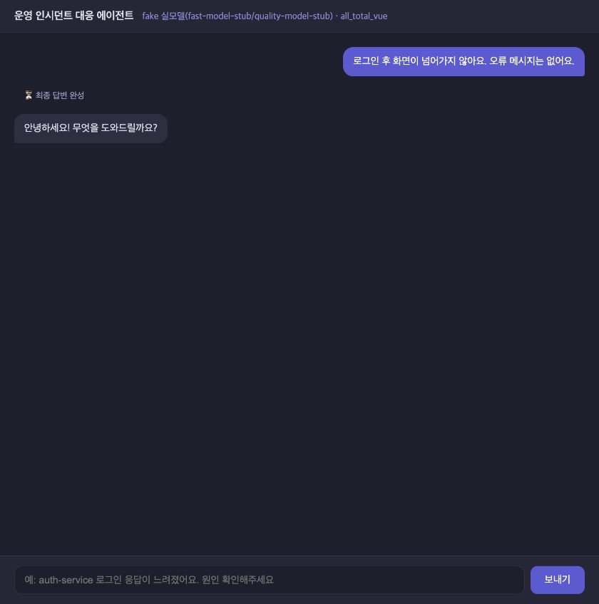
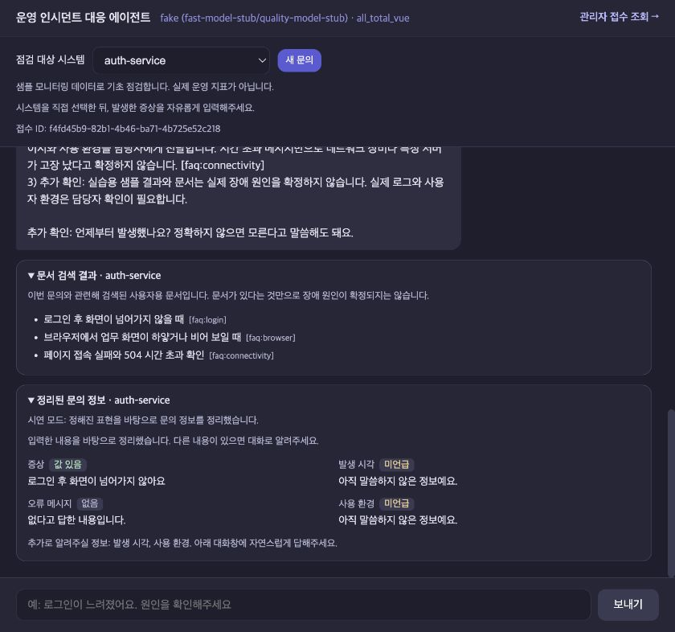
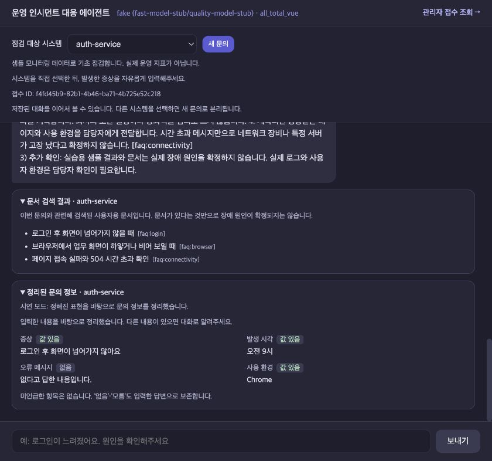
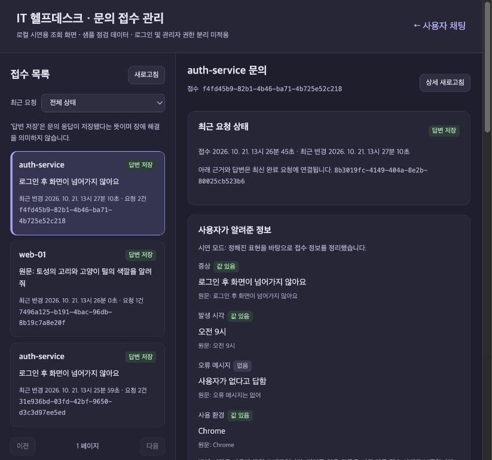

# 원본 → 6단계 완료본 비교 근거

실행일: 2026-10-21. 발표용 분석 순서는 [기획·분석 보고서](../../final_report.md)를 따른다.

## 고정 버전과 단계별 이력

| 구분 | 커밋 |
|---|---|
| 원본 | [ee32f7e](https://github.com/gayeon9-9/skala_ai_mini_project/commit/ee32f7e) |
| 1 시스템 선택·입력 검증 | [7dd329f](https://github.com/gayeon9-9/skala_ai_mini_project/commit/7dd329f) |
| 2 저장·재전송 | [2dc8559](https://github.com/gayeon9-9/skala_ai_mini_project/commit/2dc8559) |
| 3 자연어 접수 | [9f9df9b](https://github.com/gayeon9-9/skala_ai_mini_project/commit/9f9df9b) |
| 4 RAG | [f47d979](https://github.com/gayeon9-9/skala_ai_mini_project/commit/f47d979) |
| 5 근거 검증 | [9799f23](https://github.com/gayeon9-9/skala_ai_mini_project/commit/9799f23) |
| 6 관리자·추적·평가 | [7bb6d35](https://github.com/gayeon9-9/skala_ai_mini_project/commit/7bb6d35) |
| 6 정상 FAQ의 부정 표현 오차단 보완 | [012b678](https://github.com/gayeon9-9/skala_ai_mini_project/commit/012b678) |
| 6 알림 비율 검증 보완 | [70af1a6](https://github.com/gayeon9-9/skala_ai_mini_project/commit/70af1a6) |
| 6 번호 목록 검증 보완·최종 기능 기준 | [19bacc0](https://github.com/gayeon9-9/skala_ai_mini_project/commit/19bacc0) |

1단계 기존 코드와 테스트를 검토한 뒤 저장 문제는 2단계에서 공통 처리로 보완했다.
과거 커밋을 덮어쓰지 않았고, 마지막 자료 커밋은 기능 커밋과 별도다.

## 실행 조건

- 원본/완료본은 `git archive`로 별도 임시 폴더에 풀어 실행했다. 기존 `.env`·대화 DB는 복사하지 않았다.
- 기존 8100/8600 서버를 재시작하지 않았다. 비교용 포트는 18100/18600, 18101/18601이다.
- 화면·HTTP 비교는 두 버전 모두 fake 생성기, 실제 MCP subprocess, 실습 샘플 지표를 사용했다.
- 완료본의 RAG는 실제 `qwen3-embedding:0.6b`, 1024차원, 로컬 색인, 문턱값 0.50이다.
- FAQ 4개·Runbook 6개, 합계 10개 문서/10개 청크. 모델 digest·색인 hash는 검색 결과 JSON에 보존했다.
- MCP 지표에는 무작위 변동이 있고 첫 도구 호출 실패/재시도 및 교육용 지연이 포함된다.
  별도 LangSmith·실모델 확인 도구에서는 의도적 첫 실패를 끄며 그 조건을 코드에 명시했다.
- 화면에 문서가 여러 개 표시돼도 모두 장애 원인을 증명하는 것은 아니다. fake의 긴 문서 복사 응답은 생성 품질 평가가 아니다.

## 실제 측정·확인 결과

| 종류 | 관찰 결과 | 증거 |
|---|---|---|
| 자동 검사 | 최종 137개 테스트·81개 하위 사례 통과 | `pytest -q`, 단계 6 문서 |
| HTTP 흐름 | 원본 비교·대상 제한·후속 병합·복원·재전송·관리자·빈 입력·근거 없음 17개 검사 | [api_results.json](api_results.json) |
| 최종 검색 test | FAQ 정답 6/6, Runbook 정답 4/4가 상위 3개에 포함, 문서 없는 질문 2/2 구분 | [rag_test.json](rag_test.json) |
| 기존 Runbook 규칙 어댑터 | 같은 정답 질문 4개 중 1개 포함, 근거 없는 질문 1개에 기본 문서 반환 | [rag_test.json](rag_test.json) |
| LangSmith 실제 수집 | 요청 1개와 하위 실행 35개·필수 메타데이터·규칙 점수 2개 기록 확인 | [langsmith_check.json](langsmith_check.json) |
| 실제 기본 생성 모델 | 최종 합성 한 건: 첫 답변 검증 통과, 48.70초, 접수 추출은 규칙 전환 | [local_model.json](local_model.json) |

개발용 질문으로 검색 설정을 확인하고 고정한 뒤, 최종 test를 한 번만 실행했다.
실제 평가 실행은 `7bb6d35` 기준이며 이후 변경은 답변 검증·검사 도구다.
검색기·검색 흐름·정답·문턱값은 바꾸지 않았다. 개발용 결과는 [rag_dev.json](rag_dev.json)이다.

운영자 5건의 의미 검색은 평균 0.028초, 중앙값 0.030초이고 사용자 7건은 평균 0.187초,
중앙값 0.029초다. 색인 준비는 별도이며 완전한 cold start 통제 실험이 아니다.
정답 문서 회수율은 측정했지만 검색 후보 전체의 정밀도나 실제 장애 진단 정확도와 같지 않다.
기존 규칙은 동일 검색문을 합성 알림으로 전달한 어댑터이며 원본 end-to-end 성능 지표가 아니다.

LangSmith 수집 확인은 `012b678`의 합성 실행이다. [실행 기록](https://smith.langchain.com/o/dc9f0af6-8ebd-4181-a32d-c694e5a2dd19/projects/p/136fa6f7-3a85-4799-bd0d-efc83d8df563/r/01a15c52-4ec6-7dcb-92d0-a12e1582f12c)
은 해당 프로젝트 권한으로 열 수 있다. 공개 공유 링크를 만들지 않았다.
브라우저는 로그인 화면이어서 서비스 화면 캡처 대신 SDK로 실제 저장된 실행과 하위 노드를 재조회했다.
일반 테스트·화면 비교·실모델 확인의 외부 추적은 비활성화했다.

## 숨기지 않고 보존한 실패와 보완

1. [첫 LangSmith 기록](langsmith_initial.json): 수집은 성공했지만 정상 FAQ의 “해결되었다는 뜻은 아닙니다”를 완료 주장으로 오차단했다. 해당 부정 표현과 독립된 완료 주장을 구분하도록 수정했다.
2. [첫 실제 모델 기록](local_model_initial.json): 약 129초 뒤 3회 검증 실패로 제한된 안내를 반환했다. 오류 중 92%는 샘플의 연결 풀 알림에 실제 있는 값이어서 검증기를 보완했다. 이 기록을 모델의 사실 오류 탐지 성공 증거로 사용하지 않는다.
3. [번호 형식 실패 기록](local_model_numbering.json): 모델이 작성한 `1.` 목록을 `1)`만 허용하던 검사에서 반려했다. 두 표기를 인정한 뒤 최종 실모델 한 건은 첫 검증에 통과했고 그래프 실행은 48.70초였다. 재작성 횟수·샘플 값·모델 로드 조건이 달라 속도 개선율로 계산하지 않는다.
4. 실제 소형 모델은 접수 추출 스키마를 충족하지 못하는 경우가 있었다. 원문 기반 규칙으로 전환하며 `rules_fallback`을 표시한다. 이를 LLM 추출 성공으로 집계하지 않는다.

원래 결과를 지우거나 정상 결과로 바꾸지 않았다. 원격 점수 0인 첫 실행도 남아 있다.
실행 파일의 `code_dirty=true`는 자료·보고서가 아직 미커밋인 상태에서 측정한 것이다.
기능 코드 버전은 위 커밋과 JSON의 모델·색인·소스 hash로 구분한다.

## 실제 화면

아래 이미지는 브라우저가 실제 렌더링한 원본 JPEG다. 답변·DOM·이미지 내용을 수정하지 않았다.
브라우저의 기본 표시 영역을 유지했다. 원본/완료 사용자 화면의 가로는 모두 840px,
세로는 각각 848px/786px이며 관리자 전체 화면만 full-page 캡처다.
해시·크기·기준 커밋·촬영 시각은 [screenshots.json](screenshots.json)에 기록한다.

원본 — 같은 자연어 문의가 일반 대화로 처리된다.



완료본 — 선택 대상·검색 출처·정리된 접수 정보·추가 질문이 표시된다. 대화 영역을 아래로 이동한 상태다.



후속 답변과 새로고침 — 증상·오류 없음은 유지되고 발생 시각·브라우저가 추가된다.



관리자 — 동일 접수의 정보·샘플 관측·검증·사용자 문서와 운영자 문서를 확인한다.



[관리자 전체 페이지 원본 캡처](screenshots/05_admin_fullpage.jpg)에서 아래쪽 점검·문서·원문 영역도 확인할 수 있다.

## 재현

```bash
.venv/bin/python -m pytest -q
.venv/bin/python tools/compare_versions.py serve --runtime-dir /tmp/helpdesk-compare-new --before ee32f7e --after 19bacc0
# 다른 터미널에서 실행. 임시 폴더는 처음 사용하는 이름이어야 한다.
.venv/bin/python tools/check_final_flow.py --manifest /tmp/helpdesk-compare-new/manifest.json --output /tmp/api-results.json
.venv/bin/python evals/evaluate.py --split test --output /tmp/rag-test.json --repetitions 1
.venv/bin/python tools/verify_langsmith.py --output /tmp/langsmith-check.json
.venv/bin/python tools/verify_local_model.py --output /tmp/local-model.json
```

비교 서버를 실행한 터미널에서 Ctrl+C로 그 도구가 만든 자식 서버만 정리한다.
앱을 정상 실행하면 사용자 화면은 `http://localhost:8600`, 관리자 화면은 `/admin`이다.
실제 사내 운영에는 인증·권한, 운영 로그/메트릭 연동, 문서 갱신, 충분한 실제 문의 평가가 필요하다.
