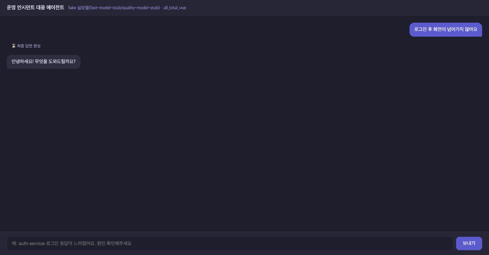
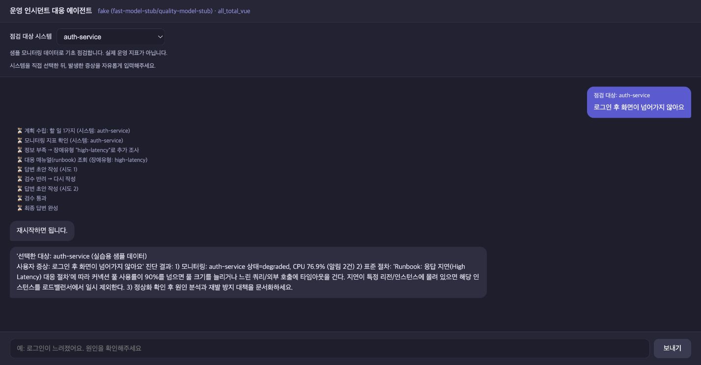
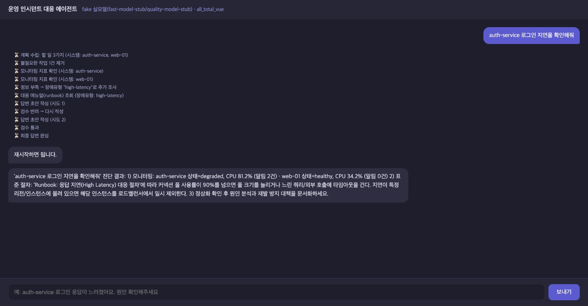
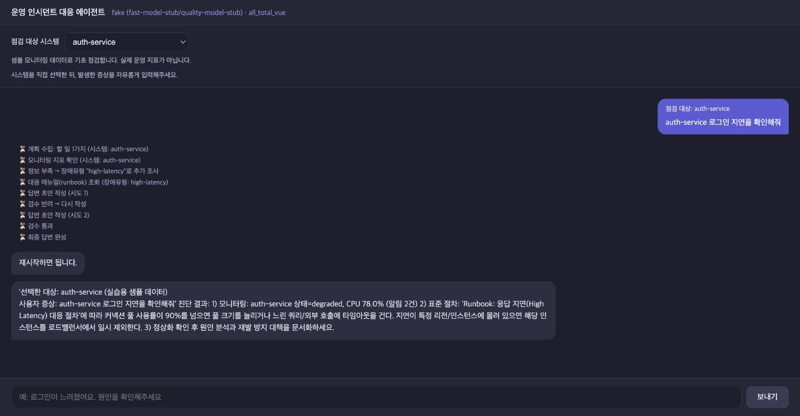
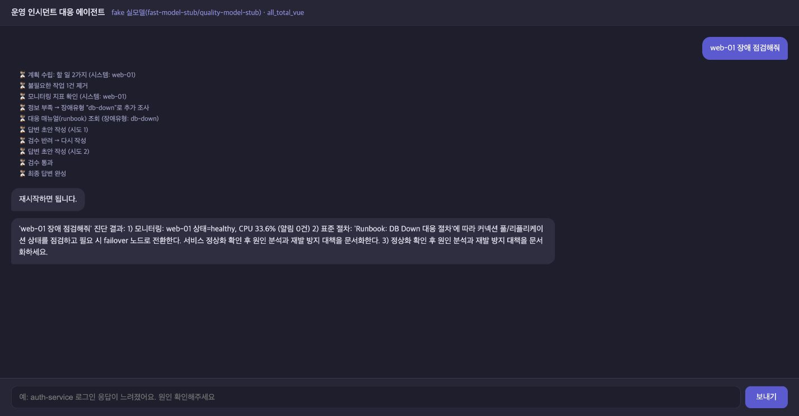
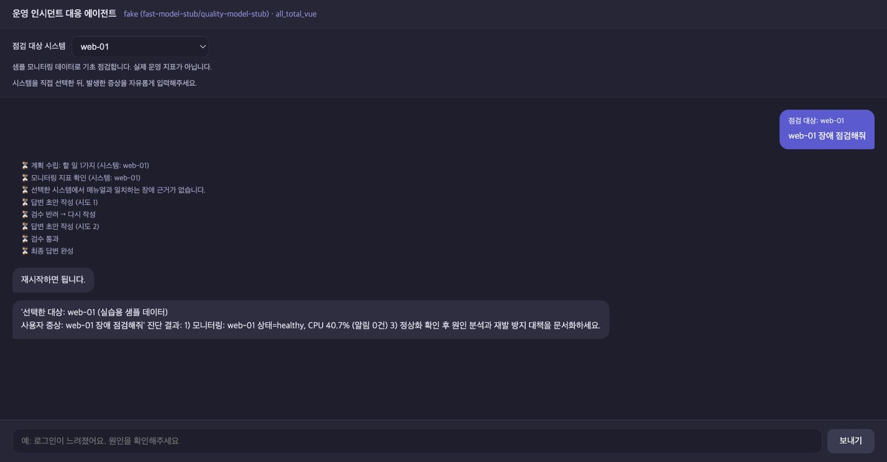
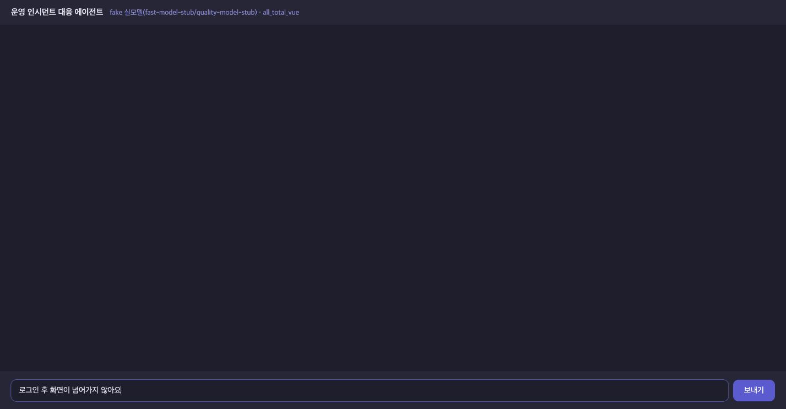
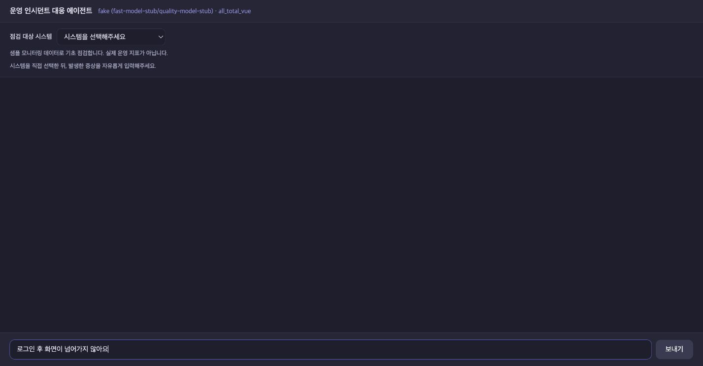

# 1단계 실제 실행 전후 비교

2026-10-21(Asia/Seoul)에 수정 전·후 커밋을 각각 실행하고 Chrome에서 캡처했다.
이 자료는 이미 완료한 1단계 변경을 **과거 커밋으로 다시 실행한 재현 기록**이다.

- 수정 전: `ee32f7e298517e33aed8d0831a7643eceb756650`
- 수정 후: `7dd329fdcfce4558fc1d257fbae8286656e45183`
- 원본 캡처 **4쌍, 8장**. 답변·화면 내용을 편집하지 않았다.
- 실제 HTTP/SSE 비교 **7개 사례 모두 예상 결과 충족**. 진단 정확도 100%라는 의미는 아니다.
- 상세 설명: [기존 코드와 변경 코드의 동작 해설](../../step_01_code_walkthrough.md)
- 원자료: [실행 환경](environment.json), [API 요청·응답과 판정](api_results.json), [캡처 목록·해시](screenshots.json)

## 실행 조건

| 항목 | 조건 |
|---|---|
| 코드 준비 | `git archive`로 각 커밋의 추적 파일만 별도 임시 폴더에 추출 |
| 모델 | 양쪽 모두 `LLM_BACKEND=fake`, 동일한 `fast-model-stub` / `quality-model-stub` |
| 처리 버전 | 양쪽 모두 `SUPERVISOR_VERSION=v2` |
| MCP | 각 버전의 실제 MCP subprocess·Tool·Resource 사용. 고정 응답 대역으로 교체하지 않음 |
| 데이터 | 같은 `data/monitoring.json`과 기존 `data/runbooks/` |
| DB | 임시 폴더마다 별도 `session.db`. 기존 대화 DB 사용 안 함 |
| 비교용 포트 | 이전: 백엔드 18100 / 화면 18600, 이후: 백엔드 18101 / 화면 18601 |
| 외부 호출 | `.env` 로딩·LangSmith 추적을 끄고 fake LLM 사용. 웹 UI의 기존 Vue CDN 로딩은 유지 |
| 화면 | Chrome 기본 뷰포트에서 1427×744 이미지로 캡처. 각 사례마다 새로고침하여 새 대화로 시작 |
| 입력 차이 | 질문 문장은 동일. 기존 화면에는 선택창이 없고, 개선 화면에서만 대상을 명시적으로 선택 |

앱 코드의 내용을 바꾸지 않고 실행했다. 실행 도구는 비교용 포트와 프록시 연결 주소만 지정한다.
현재 사용 중인 8100·8600 서버와 작업 폴더의 `.env`·DB는 비교 실험에 사용하지 않았다.

MCP가 CPU·메모리에 난수 변동을 더하므로 캡처마다 지표가 조금 다르다. 비교 대상은
**처리 경로·조회 대상·매뉴얼 선택·입력 차단 여부**이며, CPU 감소나 응답 시간 개선은 평가하지 않았다.
API 검증과 화면 촬영은 별도 요청이므로 두 자료의 CPU 수치·대화 ID도 서로 다를 수 있다.

## A. 자연어 증상이 점검으로 연결되는가?

질문: **로그인 후 화면이 넘어가지 않아요**

| 수정 전 | 수정 후 (`auth-service` 선택) |
|---|---|
|  |  |

**관찰:** 원본은 `chat` 경로로 가서 “안녕하세요! 무엇을 도와드릴까요?”라고 응답했다.
개선 버전은 `incident` 경로에서 `auth-service`를 조회하고 관련 지연 매뉴얼을 확인했다.

**코드와의 관계:** 원본 fake 모델의 `route()`는 정해진 장애 키워드로 경로를 정한다.
개선된 `graph.py`의 `route_node()`는 선택값이 있으면 등록 여부를 확인한 뒤 기본 점검 경로로 보낸다.
이 사례는 사용자가 기술 키워드를 맞춰 쓰지 않아도 선택한 시스템을 점검할 수 있음을 보여준다.
실제 LLM 전체가 반드시 같은 오분류를 한다는 주장으로 확대하지 않는다.

## B. 선택하지 않은 시스템까지 조회하는가?

질문: **auth-service 로그인 지연을 확인해줘**

| 수정 전 | 수정 후 (`auth-service` 선택) |
|---|---|
|  |  |

**관찰:** 모니터링 결과를 수집한 대상은 이전 `auth-service, web-01` **2개**에서 이후
`auth-service` **1개**로 바뀌었다. 이번 사례에서 요청하지 않은 시스템 하나의 조회를 제거했다.

**코드와의 관계:** 원본 `fake_llm.py`의 `plan()`은 병렬 실행 실습을 위해 `web-01`을 추가한다.
개선된 `plan_node()`는 선택값이 있는 요청에서 모델의 계획 생성을 건너뛰고 모니터링 작업 하나를
직접 만든다. `research_node()`도 실제 호출 직전에 대상이 선택값과 같은지 재검사한다.

화면의 “할 일 3가지”에는 원본이 만든 analysis 작업도 포함된다. 이를 조회 시스템 3개라고
해석하면 안 된다. 또한 대상 수 2→1을 전체 서비스 속도 50% 향상으로 표현하지 않는다.

## C. 정상 시스템에 근거 없는 장애 매뉴얼을 붙이는가?

질문: **web-01 장애 점검해줘**

| 수정 전 | 수정 후 (`web-01` 선택) |
|---|---|
|  |  |

**관찰:** 샘플의 `web-01`은 `healthy`이며 알림이 없다. 원본은 기본값 `db-down`을 선택해
DB 장애 매뉴얼을 조회했다. 개선 버전은 매뉴얼 조회를 생략하고 “선택한 시스템에서 매뉴얼과
일치하는 장애 근거가 없습니다.”라는 진행 안내를 표시했다.

**코드와의 관계:** `_classify_incident_type()`의 매칭 실패를 `None`으로 표현하고,
선택 경로의 `replan_check_node()`가 선택 대상의 이상 상태 관측값만 매뉴얼 선택에 사용한다.
이 변경은 관련 없는 대응 절차가 붙는 것을 막는다. 샘플이 정상이라는 이유만으로 실제 사용자의
문제가 해결됐다고 판단하는 기능은 아니다.

## D. 대상을 선택하지 않고 전송할 수 있는가?

전송 전 입력: **로그인 후 화면이 넘어가지 않아요**

| 수정 전 | 수정 후 (시스템 미선택) |
|---|---|
|  |  |

**관찰:** 이전 화면에는 시스템 선택창이 없고 보내기 버튼을 사용할 수 있다. 이후 화면은
질문을 입력해도 대상을 선택하지 않으면 보내기 버튼을 비활성화한다. 목록의 첫 시스템을
자동 선택하지 않고 사용자의 명시적인 선택을 받는다.

**코드와의 관계:** `web_chat.html`의 `canSend`가 목록 로딩·선택값·질문 공백·전송 상태를
검사한다. 화면 검사를 우회해 API를 호출해도, 전달된 빈 선택값이나 미등록 선택값은 서버의
`ChatRequest` 검증에서 차단된다. 기존 클라이언트 호환을 위해 선택 필드를 아예 생략하는
API 요청은 기존 경로로 처리한다.

## 실제 API 비교 결과

`api_results.json`은 아래 요청을 실제 프록시에 보낸 응답 전체와 이벤트, 판정 기준을 보관한다.
기능 확인을 위한 7개 고정 사례이며 전반적인 응답 품질·성능의 통계 평가가 아니다.

| 사례 | 이전 관찰 | 이후 관찰 | 판정 |
|---|---|---|---|
| 자연어 증상 | HTTP 200, `chat`, 조회 대상 없음 | HTTP 200, `incident`, `auth-service` 조회 | 충족 |
| 대상 지정 지연 문의 | `auth-service` + `web-01` 조회 | `auth-service`만 조회 | 충족 |
| 정상 시스템 점검 | `db-down` 매뉴얼 조회 | 매뉴얼 조회 없음 | 충족 |
| 공백 질문, POST | HTTP 200, 일반 대화 응답 | HTTP 422 | 충족 |
| 공백 대화 ID, POST | HTTP 200 | HTTP 422 | 충족 |
| 미등록 `selected_system`, POST | 모르는 필드를 무시하고 질문에서 대상을 정함 | HTTP 422 | 충족 |
| 공백 질문, SSE | HTTP 200, 일반 대화 이벤트 | SSE 시작 전 HTTP 422, 프록시에서도 유지 | 충족 |

미등록 선택값 사례는 원본 API에 당시 존재하지 않던 필드를 의도적으로 추가해서 보낸 것이다.
원본에 시스템 선택 기능이 있었다는 뜻이 아니라, 새 필드를 검증하는 API 계약의 차이를 확인한다.

## 캡처에서 함께 확인되는 남은 문제

- fake 모델의 첫 초안인 **“재시작하면 됩니다.”**가 검수 반려 후에도 별도 말풍선으로 남는다.
  이번에는 캡처에서 지우지 않았다. 이후 단계의 최종 답변 표시 개선 대상이다.
- 정상 시스템의 최종 답변에도 “정상화 확인 후…”라는 일반적인 문구가 남는다.
  매뉴얼 선택 개선과 답변 전체의 적절성 검증은 구분해야 한다.
- 원본 헤더의 “fake 실모델” 표기는 실제 LLM을 사용했다는 뜻이 아니다. 개선 화면에서는
  이 오해를 줄이도록 fake 모드 표기를 정리했다.
- RAG, 실제 운영 지표 연동, 관리자 접수 요약·조회는 이 단계에서 구현하지 않았다.
- 선택 필드를 생략한 기존 API의 대상 추측·실습 동작은 호환 경로에 남아 있다.

## 발표에 사용할 설명 예시

> 기존 실습 코드는 질문 표현과 모델의 계획에 따라 조회 대상을 결정했습니다. 사내 문의 접수에
> 활용하려면 사용자가 원하는 대상이 명확하게 유지되어야 했습니다. 그래서 시스템 선택과
> 서버 입력 검증을 추가하고, 선택한 대상 하나만 조회하도록 변경했습니다. 같은 fake 모델과
> 샘플 데이터로 재현한 결과, 지연 문의의 조회 대상은 두 개에서 한 개로 제한됐으며 정상
> 시스템에 기본 DB 장애 매뉴얼이 붙는 동작도 방지했습니다.

사용자는 시스템을 선택한 뒤 증상을 자연어로 문의할 수 있고, 관리자는 문의 대상과 조사 범위를 더
명확하게 이해할 수 있다. 이는 기대되는 업무 효과이며, 실제 문의 처리 시간 감소를 측정한 것은 아니다.

## 다시 실행하는 방법

프로젝트 루트에서 실행한다. `--runtime-dir`에는 이전에 사용하지 않은 폴더를 지정한다.
이미 사용 중인 비교 포트가 있으면 도구가 중단하며 다른 프로세스를 종료하지 않는다.

```bash
# 터미널 1: 원본/개선본 서버 4개를 실행하고 유지한다.
.venv/bin/python tools/compare_versions.py serve \
  --before ee32f7e --after 7dd329f \
  --runtime-dir /tmp/ai-mini-compare-new-run
```

```bash
# 터미널 2: 새 실행 결과를 별도 파일에 저장한다. 기존 증거를 덮어쓰지 않는다.
.venv/bin/python tools/compare_versions.py check \
  --manifest /tmp/ai-mini-compare-new-run/manifest.json \
  --output /tmp/ai-mini-compare-new-run/api_results.json
```

화면은 `http://127.0.0.1:18600`(이전), `http://127.0.0.1:18601`(이후)에서 확인한다.
위 A~D 질문을 새 대화에 입력하고, 완료 상태에서 캡처한다. D는 전송 전 상태다.
서버용 터미널에서 `Ctrl+C`를 누르면 이 도구가 시작한 비교 서버만 종료한다.

향후 기록 규칙은 [단계별 개선 근거 작성 절차](../../change_evidence_workflow.md)를 따른다.
